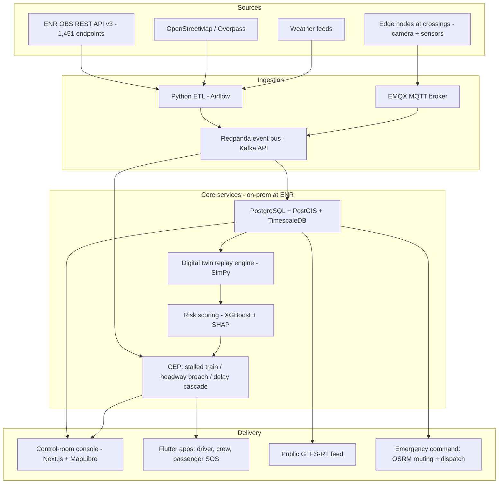

# RailGuard Egypt — Advanced B2G Rail Safety & Emergency Response Platform

**Proposal for the Egyptian National Railways (ENR) / Ministry of Transport**
Version 2.0 — November 2026 · Companion dataset: this repository (`egypt_train`)

---

## 1. Executive Summary

Egypt's railway safety problem is not a lack of plans — it is a lack of **live, measurable, network-wide visibility**. RailGuard Egypt is a government-facing (B2G) platform that turns ENR's own data into a **national rail digital twin** with three jobs: (1) predict where accidents will happen, (2) prevent them with edge intelligence at the highest-risk points, and (3) when prevention fails, cut emergency response time in half.

The feasibility work is already done: this repository contains a working national dataset — 798 trains/day timetable, 903 stations, 8,320 km of digitized track geometry, 6,805 level crossings, and validated access to ENR's official OBS API (1,451 endpoints). What remains is a 90-day pilot on the single most urgent corridor in the country: **Cairo – Giza – Al-Ayyat – Beni Suef**.

On 8 November 2026 — two days before this proposal was written — a Giza–Fayoum train **rear-ended a stationary Cairo–Aswan service at Al-Ayyat**, killing at least 7 and injuring 112, on the same corridor as the 2002 fire that killed more than 300. This document shows precisely how that class of accident (stationary-train rear-end) becomes detectable in software before it becomes a crash.

---

## 2. Why Now — The Evidence

| Fact | Significance | Source |
|---|---|---|
| **8 Nov 2026, Al-Ayyat:** rear-end collision into a stationary train; ≥7 dead, 112 injured | The exact scenario our stalled-train detection addresses; second mass-casualty event on this corridor | [BBC live](https://www.bbc.com/news/live/c6reyn7zl8rdt), [Latin Times](https://www.latintimes.com/egypt-train-collision-al-ayyat-cairo-601049) |
| **26 Mar 2021, Tahta (Sohag):** two trains collided; initial toll 32, revised 18–19 dead, ~200 injured; first ambulance arrived **~30 minutes** after the crash; speeding train hit one rolling slowly | Shows both failure modes: traffic-control human error + slow emergency mobilization | [Al Jazeera](https://www.aljazeera.com/news/2021/3/27/egypt-buries-train-crash-dead-toll-revised-to-19), [Wikipedia](https://en.wikipedia.org/wiki/Sohag_train_collision) |
| **2002, El Ayyat:** cooking-gas cylinder fire destroyed seven carriages; **more than 300 killed** | Historic worst case, same corridor as 2026 crash | [Wikipedia](https://en.wikipedia.org/wiki/2002_El_Ayyat_railway_accident), [BBC](https://www.bbc.com/news/live/c6reyn7zl8rdt) |
| **World Bank $440M loan (Mar 2021)** for railway safety; signaling modernization Cairo–Giza–Beni Suef; track upgrade on 763 km | Donor money is already committed to safety — but needs measurable outcomes | [World Bank](https://www.worldbank.org/en/news/press-release/2021/03/05/egypt-new-project-will-support-railway-safety-and-efforts-to-enhance-service-quality) |
| **Sep 2026:** World Bank flagged "high" fiduciary risk on the RISE loan; safety metric **frozen** five years in | ENR has a concrete, funded, unmet need: a system that *measures* safety | [Enterprise](https://enterpriseam.com/egypt/2026/09/06/five-years-into-rise-safety-metric-frozen-as-world-bank-ratchets-up-fiduciary-risk-on-egypts-railway-loan) |
| Network ~10,000 km (60% in the Delta/Nile valley); **Siemens €8B / 2,000 km high-speed program** signed 2022 | Scale of the asset being protected; signaling-vendor ecosystem to integrate with | [World Bank](https://www.worldbank.org/en/news/feature/2023/11/14/in-egypt-safer-and-more-efficient-railways-will-bring-wide-ranging-benefits-for-development), [Siemens](https://press.siemens.com/global/en/pressrelease/siemens-mobility-finalizes-contract-2000-km-high-speed-rail-system-egypt) |

**The window:** donor pressure for measurable safety outcomes + two mass-casualty events on one corridor + an open ENR API = the right moment to propose a decision-support layer that does not touch signaling (no safety-certification deadlock) but demonstrably reduces risk.

---

## 3. Proof of Feasibility — What Already Exists in This Repository

| Asset | Scale | Verifications performed |
|---|---|---|
| `stations_enr.csv/.json` | **903 physical stations** (4,017 records incl. trip points) | Pulled from official `obs.enr.gov.eg` API v3 |
| `timetable_2026-11-11.csv/.json` | **798 trains/day, 14,694 stop events** | Time semantics validated: departure = Σ running time + Σ dwell; reproduced the live 163 Aswan→Cairo→Alexandria schedule exactly |
| `rail_network.geojson` | **8,320 km** track, 1,489 segments, 25,188 vertices (1,790 LineStrings) | Rebuilt from binary `rail_lines.bin`; length sanity-checked against the ~10,000 km World Bank figure (difference = recent/excluded construction) |
| `rail_road_risk.csv` + `level_crossings_osm_way_ids.json` | **6,805 level crossings** (OSM way IDs) | Extracted from app binary; cross-checkable via Overpass |
| `enr_obs_openapi_spec.json` | **1,451 API endpoints** | Full OpenAPI 3 spec captured |
| `tools/` | Working CLI fetchers + parsers | Documented refresh procedure in `README.md` |

This is the difference between a slide deck and a proposal: **the national dataset pipeline already runs**.

---

## 4. The Advanced Solution — Six Subsystems

### 4.1 National Rail Digital Twin (the simulation core)
A live, replayable model of the entire network: 8,320 km geometry + 798 trains/day + station dwells.
- **Full-day national replay** in under 10 minutes on a single on-prem server.
- **Forensic timeline reconstruction**: after any incident, replay the day up to the second — positions of every train, every crossing passage, every delay. An operational black box for investigations like Tahta 2021.
- **What-if scenarios**: close a crossing, delay a train 25 min, single-track a section — see delay propagation and headway breaches before doing it in the real world. Directly useful for testing the 763 km of World Bank–funded upgrades.

### 4.2 Crossing Exposure & Risk Intelligence (the flagship differentiator)
Nobody can instrument 6,805 crossings at once — but all of them can be *modeled*. Using the validated timetable semantics (departure = Σ running + Σ dwell) and the track geometry, we compute a **Crossing Exposure Matrix**:

```
for each train T, for each segment chain between its stops:
    ETA_at_point P = last_stop_time + (dist(P) − dist(stop)) / segment_speed
→ a table of every one of the 6,805 crossings × every one of the 798 daily trains
→ "Train 971 passes crossing OSM/way/528194xxx at 14:37, southbound, ~95 km/h"
```

Outputs:
- **Risk index per crossing** (XGBoost + SHAP): exposure count × train mass/speed × road class × barrier type (from OSM tags) × time-of-day × incident history. A ranked, defensible intervention list for a fixed budget — "these 50 crossings are 41% of national exposure."
- **Driver look-ahead warnings**: the Flutter driver app announces the next N crossings with distance/speed — a modern, advisory equivalent of legacy "whistle boards."
- **Maintenance scheduling**: gate maintenance windows chosen from the twin when exposure is zero.

### 4.3 Stalled-Train & Headway CEP (answers the 8 Nov 2026 crash)
A Complex Event Processing layer watching for the exact precursors of Egypt's two recent mass-casualty collisions:
- **Stalled-train alert**: train stationary on a mainline block between stations beyond N minutes (from OBS trip polling and/or on-board GPS) → control room + all following trains within 10 km alerted.
- **Headway-breach alert**: twin-computed following distance < threshold at line speed.
- **Delay-cascade alert**: accumulation of delays on one corridor correlated with historical conflict patterns.

This is decision support layered *above* existing operations — it never drives a train, so it can deploy in months, not the decade an interlocking replacement takes.

### 4.4 Edge Safety Grid at Crossings
At the top-50 pilot crossings (chosen by 4.2):
- **AI camera node** (Jetson/RPi5 + YOLO): detects stalled/queueing vehicles on the crossing, verifies gate status, reports via MQTT with store-and-forward for connectivity gaps.
- **C-V2X pilot (optional)**: roadside units warning equipped vehicles.
- Every alert lands in the same bus as 4.3, so a "vehicle stalled at crossing K" event automatically correlates with "train 971 due in 6 minutes" into a single prioritized alert.

### 4.5 Emergency Response Command (the "accident app" for ENR)
Built around the Tahta finding (first ambulance ≈ 30 min):
- **One-click incident**: control room (or automatic detection from 4.3) opens an incident; the system instantly computes the **nearest legal track-access points** — a unique capability derived from the 6,805-crossing dataset, because crossings are precisely where fire trucks can reach the track — and routes them via on-prem OSRM.
- **Live tactical map**: full network geometry + incident position + responding units + nearest hospitals; multi-unit dispatch with Arabic-first UI.
- **Passenger SOS**: geolocated SOS + coach number from the public Flutter app, routed to the same pipeline.
- **Family/public information** workflow and post-incident replay (from the twin) for the investigation file.

### 4.6 Arabic LLM Operations Assistant (optional, phase 3)
A fully on-prem LLM (vLLM + an Arabic-capable open model) that drafts incident reports in Arabic from the twin's timeline and camera event log, answers "which crossings in Sohag governorate had exposure > 20 trains/day last month?", and prepares ministerial briefings. **No data ever leaves ENR's data center.**

---

## 5. Beyond the Basics — What Makes This "Advanced"

| Basic idea (typical proposal) | RailGuard's advanced version |
|---|---|
| "Map the tracks on a dashboard" | **National digital twin** with full-day replay, forensics, and what-if simulation |
| "Alert drivers near crossings" | **Exposure Matrix**: exact passage times for 6,805 crossings × 798 trains, driving a ranked, SHAP-explained risk index |
| "SOS button" | **Automatic incident detection** (stalled-train CEP) + command system with computed track-access routing |
| "Install cameras" | **Edge grid** targeted by the risk index; every event correlated with train positions on one event bus |
| "A report after each accident" | **Operational black box**: second-accurate replay of any day, any train |
| "AI report summarizer" (cloud) | **On-prem Arabic LLM** — data sovereignty preserved |

---

## 6. Recommended Technology Stack (and why it fits *this* case)

Constraints that drive every choice: government **on-prem deployment** (data sovereignty), **no per-use map/API fees**, **Arabic RTL** first-class, **low-cost edge hardware**, **connectivity gaps** tolerated, and reuse of skills from the existing Egypt Trains Flutter app.

| Layer | Primary choice | Why it fits Egypt / B2G | Alternative |
|---|---|---|---|
| Mobile (driver, crew, inspector, passenger SOS) | **Flutter (Dart)** | Same stack as Egypt's existing passenger app; single codebase AR/EN; runs well on low-end Android | Kotlin Multiplatform |
| Control-room web console | **Next.js + TypeScript + Tailwind + MapLibre GL JS + deck.gl** | MapLibre = zero map-API billing (gov cost control); deck.gl renders 25k-vertex geometry smoothly | OpenLayers |
| 3D twin visualization (phase 3) | **CesiumJS** | Free 3D globe, on-prem tiling possible | Unreal Engine (overkill) |
| API core / real-time fan-out | **Go** | Single static binary, tiny RAM on gov VMs, excellent WebSocket fan-out | Rust |
| ML & data services | **Python 3.12 + FastAPI + Polars** | The parsers/ETL in this repo are already Python — day-one momentum | — |
| Event backbone | **Redpanda** (Kafka API) | Kafka-compatible, one binary, minimal ops | Apache Kafka, RabbitMQ |
| Stream rules (CEP) | Kafka Streams / Redpanda Connect + Go rule engine; **Flink** at national scale | Stalled-train & headway rules are simple to start, heavy to scale | Apache Flink from day 1 |
| Databases | **PostgreSQL 16 + PostGIS + TimescaleDB**; **Redis**; **MinIO** | One RDBMS covers geo + time-series = small ops team; PostGIS is the geo standard | ClickHouse for telemetry at scale |
| Risk models | **XGBoost + SHAP** | Tabular sweet spot; **explainability is what makes it procurable** by government | LightGBM |
| Crossing vision | **Ultralytics YOLOv8 / RT-DETR** on **Jetson Orin Nano** (or RPi5 + Hailo-8L for budget builds) | Runs offline at the crossing; LTE store-and-forward | — |
| Edge connectivity | **EMQX (MQTT)** over cellular; optional C-V2X RSU pilot | QoS levels, offline buffering, on-prem broker | Mosquitto |
| Simulation | **SimPy** discrete-event + this repo's parsers | Open-source, reproducible, already half-built | OpenTrack (commercial) |
| Emergency routing | **OSRM** on an OSM Egypt extract | Free, offline-capable, exact-crossing access points | Valhalla |
| Identity & secrets | **Keycloak** + **HashiCorp Vault** | LDAP/AD for ENR staff roles; secrets never in code | Ory stack |
| Observability | **Prometheus + Grafana + Loki** | On-prem standard; KPI dashboards for the World Bank metrics for free | — |
| Deployment | **Docker + K3s** (lightweight Kubernetes) + Ansible + Harbor offline registry | Runs inside ENR's data center; air-gap friendly | Docker Swarm |
| Orchestration of data jobs | **Airflow** (pilot: systemd timers) | Nightly ENR pulls are already scripted in `tools/` | Dagster |
| Public data exports | **GTFS + GTFS-RT feed generator** | Transparency + instantly feeds any consumer app ecosystem | SIRI |
| LLM (optional) | **vLLM serving an Arabic-capable open model** | Fully on-prem; no data egress | Cloud APIs — rejected (sovereignty) |

**Architecture:**



**Deliberate exclusions** (and why): no cloud-managed Kafka/DB (sovereignty), no Google Maps (billing), no microservice zoo (K3s + one Go binary + one Python service is operable by a small ENR IT team), no safety-critical certification scope in phase 1 (advisory layer only, using EN 50126 RAMS vocabulary to frame the future safety case).

---

## 7. Data & Integration

- **ENR OBS API v3** (`obs.enr.gov.eg`): stations, timetable, ticket search — validated without authentication; full 1,451-endpoint spec in this repo. Integration layer normalizes OBS polling into the event bus.
- **GTFS-RT public feed**: generated from the timetable — immediate transparency win and an ecosystem multiplier for app developers.
- **Standards posture**: phase 1 is advisory decision-support (no interlocking), framed with EN 50126/50128 RAMS terminology so a future safety case can be built without re-architecture.

---

## 8. 90-Day Pilot — Cairo–Giza–Al-Ayyat–Beni Suef

Chosen deliberately: it is the World Bank's signaling-modernization segment **and** the corridor of both the 2002 and 2026 disasters.

| Days | Milestone |
|---|---|
| 0–15 | OBS integration live; Exposure Matrix v1 (all 6,805 crossings × 798 trains); risk index v1 + SHAP report; control-room console MVP |
| 15–45 | Edge nodes installed at top-50 risk crossings; stalled-train CEP live on the corridor (OBS polling + on-board GPS on 20 trains); driver advisory app beta on 1 district; OSRM emergency routing live |
| 45–90 | Joint tabletop exercise with ENR civil protection; KPI report mapped to World Bank RISE indicators; national scale-out plan and TCO |

**KPIs:** 100% of crossings risk-scored · edge→control alert latency < 3 s · stalled-train detection < 60 s (edge districts) / < 5 min (API-only districts) · nearest track-access route delivered < 10 s · target: first-responder arrival < 15 min in pilot districts (Tahta 2021 baseline: ~30 min) · full-day national replay < 10 min.

**Indicative pilot budget** (transparent arithmetic, to be refined with ENR scope):
- Edge nodes: 50 × USD 3,000–4,500 (camera + Jetson/RPi5 + enclosure + LTE + install) ≈ **150–225k**
- Software + integration team, 90 days ≈ **150–250k**
- On-prem servers (2 nodes + storage) ≈ **20–40k**
- **Total ≈ USD 320–515k** — under 0.15% of the $440M World Bank loan it supports.

---

## 9. Risks & Mitigations

| Risk | Mitigation |
|---|---|
| OBS API changes or restricted access | Spec archived in repo; agreement for a stable internal endpoint in the MOU |
| Connectivity gaps on rural sections | MQTT store-and-forward; API-only degraded mode (5-min detection instead of 60 s) |
| Adoption/change management at control rooms | Advisory-first UI; SHAP explanations; ENR operators in the pilot loop from day 0 |
| Model credibility | Explainable models only; per-crossing audit trail; human-in-the-loop |
| Procurement cycle length | Pilot structured as a funded research MOU, not a tender; open-source stack lowers exit barriers |
| Safety overreach | Hard boundary: advisory layer, never connected to interlocking/signaling |

---

## 10. B2G Go-to-Market

1. **Anchor to the World Bank RISE program** — it has $440M committed, and reported fiduciary concerns over frozen safety metrics. RailGuard *is* the measurement and early-warning layer that de-risks that loan. (This is the lead argument in every meeting.)
2. **Pilot corridor = political narrative**: "the Al-Ayyat corridor never happens again the same way."
3. **Second phase**: Delta network (60% of the 10,000 km), then integration dialogue with the Siemens high-speed program as a greenfield network.
4. **Funding instruments**: World Bank/EIB technical-assistance windows; Ministry of Transport digitalization budget; open-source stack keeps TCO low for national rollout.

---

## 11. Immediate Next Steps

- [ ] Share this repository + proposal with ENR RDA / Ministry of Transport digitalization office
- [ ] Request a working session with the World Bank RISE project team (safety-metric alignment)
- [ ] MOU scope: 90-day pilot on Cairo–Beni Suef + 50 crossings
- [ ] ENR grants read access to OBS internal endpoints + 20 on-board GPS units
- [ ] Deliver Exposure Matrix v1 and the top-50 crossing list within 15 days of kickoff

---

## 12. References

1. BBC News — live coverage, Al-Ayyat collision, 8 Nov 2026: https://www.bbc.com/news/live/c6reyn7zl8rdt
2. Latin Times — 7 dead, 112 injured, rear-end at Al-Ayyat (2026): https://www.latintimes.com/egypt-train-collision-al-ayyat-cairo-601049
3. Al Jazeera — Sohag/Tahta crash toll revised to 19, 27 Mar 2021: https://www.aljazeera.com/news/2021/3/27/egypt-buries-train-crash-dead-toll-revised-to-19
4. Wikipedia — Sohag train collision (2021): https://en.wikipedia.org/wiki/Sohag_train_collision
5. Wikipedia — 2002 El Ayyat railway accident: https://en.wikipedia.org/wiki/2002_El_Ayyat_railway_accident
6. World Bank — $440M railway safety project press release (2021): https://www.worldbank.org/en/news/press-release/2021/03/05/egypt-new-project-will-support-railway-safety-and-efforts-to-enhance-service-quality
7. World Bank — safer railways feature, network scale (2023): https://www.worldbank.org/en/news/feature/2023/11/14/in-egypt-safer-and-more-efficient-railways-will-bring-wide-ranging-benefits-for-development
8. Enterprise — World Bank flags fiduciary risk on RISE loan (Sep 2026): https://enterpriseam.com/egypt/2026/09/06/five-years-into-rise-safety-metric-frozen-as-world-bank-ratchets-up-fiduciary-risk-on-egypts-railway-loan
9. Siemens Mobility — 2,000 km high-speed rail contract (2022): https://press.siemens.com/global/en/pressrelease/siemens-mobility-finalizes-contract-2000-km-high-speed-rail-system-egypt
10. Wikipedia — Egyptian National Railways: https://en.wikipedia.org/wiki/Egyptian_National_Railways
